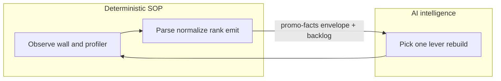
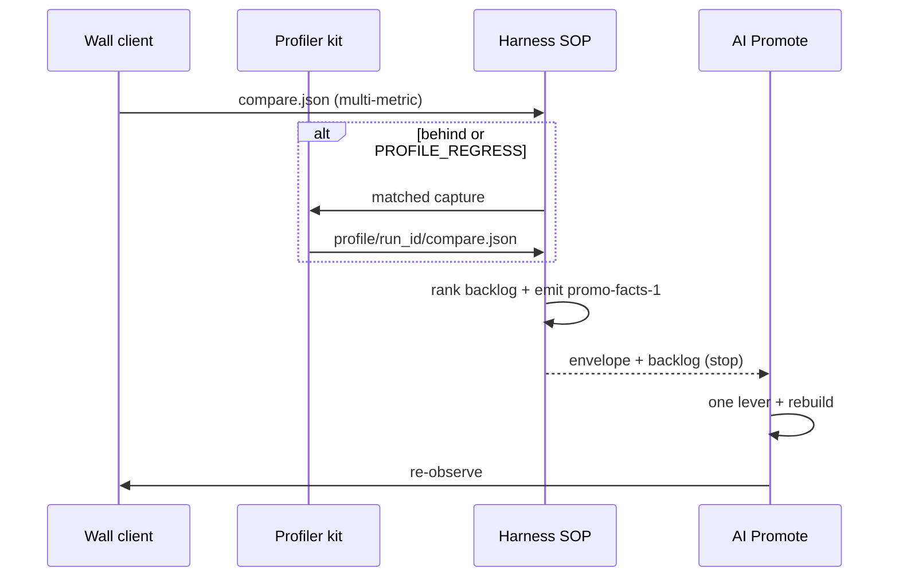

# Performance Promotion E2E (Observe→Parse + promo-facts)

Date: 2026-11-17  
Related: [case-diagnostic-contract.md](./case-diagnostic-contract.md), skill
`performance-promotion-loop`

## Overview

Performance promotion is a closed loop that compares InfiniLM (candidate) to a
frozen vLLM baseline on one host/cell, ranks where to spend the next rebuild,
and ships only when an **unprofiled** wall KPI **surpasses** the baseline.

This document is the **normative contract** for:

1. The deterministic **Observe→Parse** SOP (harness-scriptable).
2. The durable **`promo-facts-1`** envelope (CampaignFact identity, multi-metric
   `walls[]`, backlog, ship).
3. Harness bins and compact warehouse emit identity columns.

**Promote** (pick one lever, rebuild candidate) is owned by **AutoHelix + Codex**
(iteration / accept / reject / budget). InfiniOrchestrator remains the
deterministic measure backend (`loop_step` → facts/backlog; env hooks
`PROMO_LEVER_APPLIED`, `PROMO_EXHAUSTED`, `PROMO_AGENT_IDS`, `AUTOHELIX_RUN_ID`).
Harness still never auto-applies levers. Surpass/ship stays human after the
ITW `stop_surpass.py` helper. Grafana publish is **deferred**; use
`autohelix watch` for the first campaigns. Visualization remains an allowed
**consumer** of validated facts (see
[continuous-profiling-viz.md](./continuous-profiling-viz.md)), but is **not**
part of the Observe→Parse SOP itself. Tooling feature requirements for
continuous profiling on the LLM inference stack (Nsight vs hcTracer, CUPTI vs
HCPTI, scheduler-effort gaps) are surveyed in
[continuous-profiling-llm-tooling-survey.md](./continuous-profiling-llm-tooling-survey.md).



## 1. Purpose & roles

| Role | Owns | Does not |
|------|------|----------|
| **InfiniOrchestrator (IO)** | Client wall observe, gates, playground cases, suite `facts/`, harness SOP bins, warehouse emit of promo rows | InfiniLM kernel source; auto-apply levers |
| **InfiniTensorWorktree (ITW)** | Lever code/env, rebuild image/worktree, ITW release tag | AIPerf dual recipe; inventing wall ratios |
| **Host profiler kit** | Matched capture + summarize/compare/promote helpers (DLPTI on Denglin QY; mcTracer on MetaX QY/showroom) | Shipping IO cases alone; wall ship KPI |

**Facts** (`promo-facts-1`) are the durable product of Observe→Parse. Vendor
artifacts (AIPerf `compare.json`, DLPTI/mcTracer compare, FINDINGS prose) are
**sources** normalized into the envelope — not interchangeable with it.

Client wall is the **KPI**. Profiler compare ranks **where** to spend the next
rebuild; it does not replace wall ratio.

---

## 2. E2E pipe (normative)

### 2.1 One-turn flow

```text
1. Observe wall (unprofiled A/B) → $SUITE_DIR/compare.json
2. If behind / any PROFILE_REGRESS → Observe matched profiler (same prompt/window)
3. Parse → namespaced profile/<run_id>/compare.json + promotion_backlog.json
4. Normalize/rank → emit promo-facts-1 under $SUITE_DIR/facts/
5. Measure returns (`controller: autohelix`); AutoHelix accepts/rejects
6. Codex (inside AutoHelix) applies one top_path lever → ITW rebuild → re-observe
```



### 2.2 Suite directory layout

```text
$SUITE_DIR/
  baseline/vllm/summary.json          # wall baseline
  candidate/infinilm/summary.json     # wall candidate
  compare.json                        # wall gate (AIPerf / harness / evalscope)
  facts/
    campaign.json                     # CampaignFact (+ optional iters[] inline)
    iters.jsonl                       # one IterFact per line (preferred)
    # OR iter<N>.json
  profile/<run_id>/
    compare.json                      # profiler compare (namespaced; never overwrite wall)
    promotion_backlog.json
    FINDINGS_iterationN.md            # optional prose; not a substitute for facts
  FINDINGS_surpass_nogo.md            # if ship blocked
```

HTML `review/` is **out of scope** here (future consumer of the same envelope).

### 2.3 Device-track routing

| `device_track` | Wall | Profiler in SOP | Notes |
|----------------|------|-----------------|-------|
| `qy` | harness / AIPerf | **DLPTI** (`DLPTI_ROOT`) | MiniCPM5 `*-qy-*-perf`, c610 |
| `metax` | prefer `run-aiperf-dual` | **mcTracer** (`MCTRACER_ROOT`) | `qwen38-27b-qy-*`, showroom |
| `mars` | LongBench / harness / AIPerf | **none** (wall-only) until matched kit | Phytium / Hygon |
| `other` | as configured | as configured | must still set `vendor_profiler` |

Never rank from a single-backend trace. Never mix prompt shapes in one compare.

---

## 3. Spec: `promo-facts-1`

**Schema id:** `promo-facts`  
**Version:** `promo-facts-1` (additive; unknown keys ignored by readers)  
**Encoding:** UTF-8 JSON (no BOM preferred; readers SHOULD tolerate BOM)

Normative skill mirror: `.cursor/skills/performance-promotion-loop/facts.md`.  
Validator: `.cursor/skills/performance-promotion-loop/scripts/parse_promo_facts.py`
(and `harness/bin/parse-promo-facts`).

### 3.1 Document roots

**Multi-campaign document (1.1)** — warehouse batch / combined payloads:

```json
{
  "schema_version": "promo-facts-1",
  "generated_at": "2026-11-17T00:00:00Z",
  "note": "optional",
  "campaigns": [ /* CampaignDocument */ ]
}
```

| Field | Type | Req | Notes |
|-------|------|-----|-------|
| `schema_version` | string | yes | Exactly `promo-facts-1` |
| `generated_at` | ISO-8601 UTC string | recommended | Envelope emit time |
| `note` | string | no | Human provenance |
| `campaigns` | CampaignDocument[] | yes | Length ≥ 1 |

**Suite layout (1.2):** `$SUITE_DIR/facts/{campaign.json, iters.jsonl|iterN.json}`.

**CampaignDocument** = `CampaignFact` fields **plus** required `iters: IterFact[]`
in layout 1.1.

### 3.2 Naming and types

| Rule | Spec |
|------|------|
| Keys | `snake_case` ASCII |
| Numbers | JSON number; ratios dimensionless floats |
| Nulls | Prefer **omit** optional fields (except explicit `lever_applied: null`) |
| Extensibility | Unknown keys MUST be ignored; writers MUST NOT rely on them for gates |

### 3.3 Shared enums

**`WallGate`:** `PASS` | `PROFILE_REGRESS` | `SURPASS` | `NO_GO`

| Value | Meaning |
|-------|---------|
| `PASS` | Wall floor passed (e.g. AIPerf dual) — **not** surpass |
| `PROFILE_REGRESS` | Behind floor / regress detect → escalate profiler |
| `SURPASS` | Unprofiled primary exceeds frozen baseline (ratio > 1.0) |
| `NO_GO` | Improved or flat but not surpass; no ship |

**`WallSource`:** `aiperf` | `harness` | `evalscope`  
(producer only — **not** the metric name)

**`VendorProfiler`:** `dlpti` | `mctracer` | `hctracer` | `aiperf` | `none`  
(Mars continuous/attach path: `hctracer`. See
[continuous-profiling-llm-tooling-survey.md](./continuous-profiling-llm-tooling-survey.md)
for Nsight/hcTracer and CUPTI/HCPTI requirements; host families below are
**not** LLM scheduler-effort.)

**`DeviceTrack`:** `qy` | `metax` | `mars` | `other`

**`HostSignalFamily`:** `driver` | `runtime` | `command` | `api` | `gap` | `graph`

**`HostSignalMappedFrom`:** `dlpti` | `mctracer` | `hctracer`

**`ShipAction`:** `matrix` | `itw_tag` | `io_case` | `none`  
(v1: one primary action string)

### 3.4 CampaignFact

Identity of one promotion campaign on one host/cell, including Standalone case
linkage (Option A).

| Field | Type | Req | Description |
|-------|------|-----|-------------|
| `campaign_id` | string | yes | Stable id (kebab-case recommended) |
| `host` | string | yes | e.g. `c610`, `metax-showroom` |
| `device_track` | DeviceTrack | yes | SOP routing (§2.3) |
| `vendor_profiler` | VendorProfiler | yes | Primary kit (`aiperf`/`none` if wall-only) |
| `hw_profile_id` | string | yes | From `case.toml` / hardware-profile |
| `hw_abbr` | string | recommended | e.g. `qy`, `x203` |
| `case_id_baseline` | string | recommended | Standalone folder id (vLLM) |
| `case_id_candidate` | string | yes | Standalone folder id (InfiniLM) |
| `be_abbr_baseline` | string | recommended | Usually `vllm` |
| `be_abbr_candidate` | string | yes | Usually `inf` |
| `cell` | string | yes | Human cell description |
| `pin_baseline` | string | yes | Frozen baseline serving/matrix pin |
| `pin_candidate` | string | yes | Candidate serving pin |
| `worktree_baseline` | string | no | Baseline IO/ITW worktree |
| `worktree_candidate` | string | no | Candidate worktree |
| `itw_tag_baseline` | string | no | ITW tag if distinct from pin |
| `itw_tag_candidate` | string | no | ITW tag if distinct from pin |
| `engine` | EngineFact | no | Compact serving knobs; omit unknowns |
| `agent_ids` | string[] | no | Agent ids that produced the campaign |
| `source_paths` | string[] | no | Compact provenance (compare/backlog/FINDINGS) |

**`EngineFact`** (optional; no invented values):

| Field | Type | Notes |
|-------|------|-------|
| `tp` | number | tensor parallel |
| `device` | string | e.g. `mars`, `metax`, `qy` |
| `graph_policy` | string | env/policy label if known |
| `batch_limit` | number | if known |
| `max_output_tokens` | number | if known |
| `extra` | object | sparse knobs already recorded on case |

### 3.5 IterFact

One Observe→Parse turn (Promote applied **after** this observe is recorded as
`lever_applied` on a later iter or the same iter once AI returns).

| Field | Type | Req | Description |
|-------|------|-----|-------------|
| `iter` | number \| string | yes | Turn index or label |
| `suite_dir` | string | no | Suite root if not implied |
| `profile_run_id` | string | no | Profiler OUT folder name |
| `lever_applied` | string \| null | no | Lever taken after this observe |
| `profiled` | boolean | yes | Whether wall numbers came under profiler |
| `walls` | WallFact[] | recommended | All metrics from this observe |
| `wall` | WallFact | no | **Legacy** mirror of primary wall |
| `host_signals` | HostSignalFact[] | no | Optional diagnostic |
| `cu_buckets` | CuBucketFact[] | no | Material CU/path buckets |
| `backlog` | BacklogFact | no | Ranked promotion paths |
| `ship` | ShipFact | no | Surpass / ship decision |

**`walls` rules:**

- Prefer `walls[]` for every new emit.
- Exactly **one** entry MUST have `primary: true` when `walls` is non-empty.
- Legacy `wall` MAY mirror the primary during transition; if both present, primary
  in `walls[]` wins for ship/host-first.
- Escalate profiler if **any** wall has `gate: PROFILE_REGRESS`.
- Surpass / ship KPI is **only** the primary wall (unprofiled).

### 3.6 WallFact

| Field | Type | Req | Description |
|-------|------|-----|-------------|
| `metric` | string | yes | Free-form KPI name (`decode_tok_s`, `output_token_throughput_per_sec`, `ttft_p95_ms`, `success_rate`, …) |
| `baseline` | number | yes | Frozen baseline value |
| `candidate` | number | yes | Candidate value |
| `WALL_DECODE_RATIO` | number | yes | `candidate / baseline` from **unprofiled** A/B (name retained for decode heritage; applies to the metric) |
| `gate` | WallGate | yes | Decision for this metric |
| `source` | WallSource | yes | Client wall producer |
| `primary` | boolean | no | Ship/host-first KPI when true; required semantics via `walls[]` rule |

### 3.7 HostSignalFact / CuBucketFact / BacklogFact / ShipFact

Unchanged from the converged skill spec:

- **HostSignalFact:** `family`, `ratio`, `mapped_from`; optional abs baseline/candidate
- **CuBucketFact:** `bucket`, `ratio`, `material`; optional `us_or_ms_per_norm`
- **BacklogFact:** `top_path`, `host_first_fired`, `ranked[]`; optional `exhausted`
- **RankedPath:** `path_id`; optional `rank`, `score`, `priority_rule`, `reasons`, `lever`, `exhausted`
- **ShipFact:** `surpass`, `actions`; optional `findings_path`

### 3.8 Integrity invariants (normative)

1. **Primary ship KPI MUST be unprofiled.** If `profiled: true`, writers MUST NOT
   present that wall as the ship KPI unless a separate unprofiled primary is
   recorded.
2. **`WALL_DECODE_RATIO` MUST NOT be invented.** Missing evidence ⇒ omit field /
   omit object.
3. **Namespaced compares** stay outside the envelope as inputs:
   - wall: `$SUITE_DIR/compare.json`
   - profiler: `$SUITE_DIR/profile/<run_id>/compare.json`
4. **Host-first:** fire `host_graph_command` when primary wall &lt; 0.9 **and**
   CU (or gpu post-load proxy) ≤ 1.0× **and** (count ≥ 2× **or** command/api_ms ≥ 2×
   **or** gap ≥ 1.5×).
5. **Surpass** ⇔ primary unprofiled ratio &gt; 1.0. AIPerf tok/s floor 0.50 is
   `PROFILE_REGRESS` detect only — not ship.
6. **Escalate** on **any** `PROFILE_REGRESS` in `walls[]` (or folded legacy `wall`).
7. **Compact provenance only** in `source_paths` (compare, backlog, FINDINGS).

### 3.9 Minimal multi-metric example

```json
{
  "schema_version": "promo-facts-1",
  "generated_at": "2026-11-17T00:00:00Z",
  "campaigns": [
    {
      "campaign_id": "qwen38-27b-qy-tp4-decode",
      "host": "metax-showroom",
      "device_track": "metax",
      "vendor_profiler": "mctracer",
      "hw_profile_id": "metax-qy-tp4",
      "hw_abbr": "qy",
      "case_id_baseline": "qwen38-27b-qy-vllm--prod-qwen38-tp4",
      "case_id_candidate": "qwen38-27b-qy-inf--prod-qwen38-tp4",
      "be_abbr_baseline": "vllm",
      "be_abbr_candidate": "inf",
      "cell": "Qwen3.8-27B TP4 AIPerf dual",
      "pin_baseline": "vllm-frozen",
      "pin_candidate": "v2026.11.xx",
      "engine": { "tp": 4, "device": "qy", "batch_limit": 1 },
      "iters": [
        {
          "iter": 0,
          "profiled": false,
          "walls": [
            {
              "metric": "output_token_throughput_per_sec",
              "baseline": 100.0,
              "candidate": 5.1,
              "WALL_DECODE_RATIO": 0.051,
              "gate": "PROFILE_REGRESS",
              "source": "aiperf",
              "primary": true
            },
            {
              "metric": "ttft_p95_ms",
              "baseline": 80.0,
              "candidate": 120.0,
              "WALL_DECODE_RATIO": 1.5,
              "gate": "PROFILE_REGRESS",
              "source": "aiperf",
              "primary": false
            },
            {
              "metric": "success_rate",
              "baseline": 1.0,
              "candidate": 1.0,
              "WALL_DECODE_RATIO": 1.0,
              "gate": "PASS",
              "source": "aiperf",
              "primary": false
            }
          ],
          "wall": {
            "metric": "output_token_throughput_per_sec",
            "baseline": 100.0,
            "candidate": 5.1,
            "WALL_DECODE_RATIO": 0.051,
            "gate": "PROFILE_REGRESS",
            "source": "aiperf",
            "primary": true
          },
          "backlog": {
            "top_path": "gated_delta_rule",
            "host_first_fired": false,
            "ranked": []
          },
          "ship": { "surpass": false, "actions": "none" }
        }
      ]
    }
  ]
}
```

### 3.10 Versioning

| Change type | Rule |
|-------------|------|
| Additive optional fields | Stay on `promo-facts-1` |
| Rename / remove / semantic break | Bump to `promo-facts-2` + mapper |
| Enum extension | Additive OK if unknown values ignored safely |

---

## 4. Harness contracts

SOP scripts implement Observe→Parse only and **exit before Promote**.

### 4.1 Bins

| Bin | Role |
|-----|------|
| `harness/bin/parse-promo-facts` | Validate / canonicalize / summarize / load-suite → skill `parse_promo_facts.py` |
| `harness/bin/rank-promotion` | Deterministic host-first + CU/score ranker; writes `promotion_backlog.json` and updates envelope backlog |
| `harness/bin/run-promotion-loop-step` | One Observe→Parse step; **exits before promote** |
| `harness/bin/emit-promo-facts` | Compact warehouse emit from suite facts / envelope |

### 4.2 `run-promotion-loop-step` behavior

1. Require `SUITE_DIR` (and campaign identity via env / `facts/campaign.json`).
2. Optional wall: reuse existing `$SUITE_DIR/compare.json` or invoke
   `run-aiperf-dual` when endpoints are configured.
3. If primary (or any) wall is behind / `PROFILE_REGRESS` and `device_track` has a
   kit: invoke profiler helpers under `DLPTI_ROOT` or `MCTRACER_ROOT` (matched
   window). Mars → skip profiler.
4. `rank-promotion` → backlog.
5. Emit / update `$SUITE_DIR/facts/` as `promo-facts-1`.
6. Print summary and exit **0** with backlog path; do **not** apply levers.

Exit codes: `0` success (facts emitted), `1` observe/parse failure, `2` usage/config.

### 4.3 Environment

| Variable | Purpose |
|----------|---------|
| `SUITE_DIR` | Suite root |
| `DEVICE_TRACK` | `qy` \| `metax` \| `mars` \| `other` |
| `DLPTI_ROOT` | Denglin QY profiler kit root |
| `MCTRACER_ROOT` | MetaX mcTracer kit root |
| `CASE_PATH` / case paths | Lift Standalone identity into CampaignFact |
| `BENCH_WAREHOUSE_REPO` | Warehouse data root for emit |

Reuse `harness/bin/run-aiperf-dual` for MetaX dual wall when live.

### 4.4 Ranker inputs/outputs

**Inputs:** wall primary ratio (from `compare.json` and/or facts), optional
`profile/<run_id>/compare.json`, optional host signals / CU buckets.

**Output:** `promotion_backlog.json`:

```json
{
  "top_path": "host_graph_command",
  "host_first_fired": true,
  "ranked": [ { "rank": 1, "path_id": "host_graph_command", "reasons": ["…"] } ],
  "exhausted": []
}
```

---

## 5. Warehouse compact emit

Suite prefix: **`promo_facts`**. Family: **`promo`**.

One warehouse row per `(campaign_id, iter)` (compact identity + JSON payload).

### 5.1 Identity columns (family metrics)

| Column | Source |
|--------|--------|
| `schema_version` | envelope |
| `campaign_id` | CampaignFact |
| `iter` | IterFact |
| `host` | CampaignFact |
| `device_track` | CampaignFact |
| `vendor_profiler` | CampaignFact |
| `hw_profile_id` | CampaignFact |
| `hw_abbr` | CampaignFact |
| `case_id_baseline` | CampaignFact |
| `case_id_candidate` | CampaignFact |
| `be_abbr_baseline` | CampaignFact |
| `be_abbr_candidate` | CampaignFact |
| `pin_baseline` | CampaignFact |
| `pin_candidate` | CampaignFact |
| `primary_metric` | primary WallFact.metric |
| `primary_ratio` | primary WALL_DECODE_RATIO |
| `primary_gate` | primary gate |
| `profiled` | IterFact |
| `top_path` | BacklogFact |
| `surpass` | ShipFact (`1`/`0`) |
| `promo_payload` | JSON blob of IterFact (+ campaign identity echo as needed) |

Shared `CASE_META_COLUMNS` / base emit columns still apply when `CASE_PATH` is set
(candidate case preferred).

Emit path: build staging + metrics JSON from validated envelope, then
`python -m bench_warehouse.emit --bench-id promo_facts__<model_or_campaign> …`
(or `harness/bin/emit-promo-facts`).

Do **not** invent ratios at emit time — only copy validated facts.

---

## 6. Non-goals

- Building Grafana / Pyroscope / HTML review **inside** Observe→Parse SOP scripts
  (viz consumes facts; see [continuous-profiling-viz.md](./continuous-profiling-viz.md))
- Freezing HTML review as the primary continuous-ops UI (Grafana folder is preferred)
- Auto-promote / auto-rebuild in harness SOP
- Replacing vendor DLPTI / mcTracer kits
- Distribution (`n ≥ 2`) topology facts
- Inventing ratios or shipping on profiled walls in any consumer (including Grafana)

---

## 7. Manual smoke checklist

1. Validate example envelope:
   `harness/bin/parse-promo-facts validate <facts.json>`
2. Rank from a suite with wall compare (+ optional profiler compare):
   `harness/bin/rank-promotion --suite-dir "$SUITE_DIR"`
3. Dry Observe→Parse step (reuse compare, no promote):
   `SUITE_DIR=… DEVICE_TRACK=mars harness/bin/run-promotion-loop-step --reuse-wall`
4. Emit compact rows (when warehouse env set):
   `harness/bin/emit-promo-facts --suite-dir "$SUITE_DIR"`
